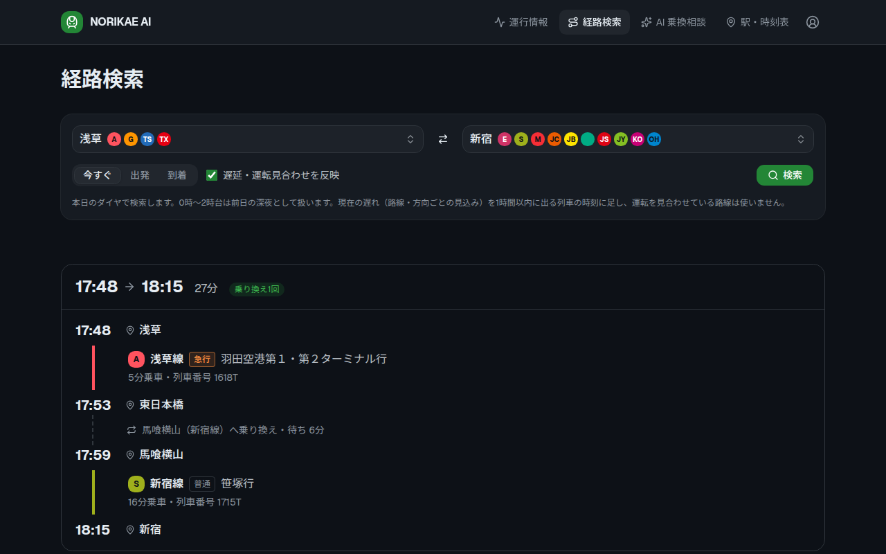
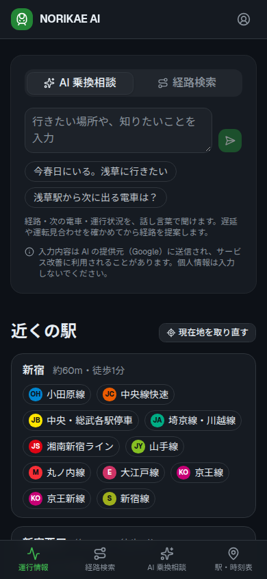
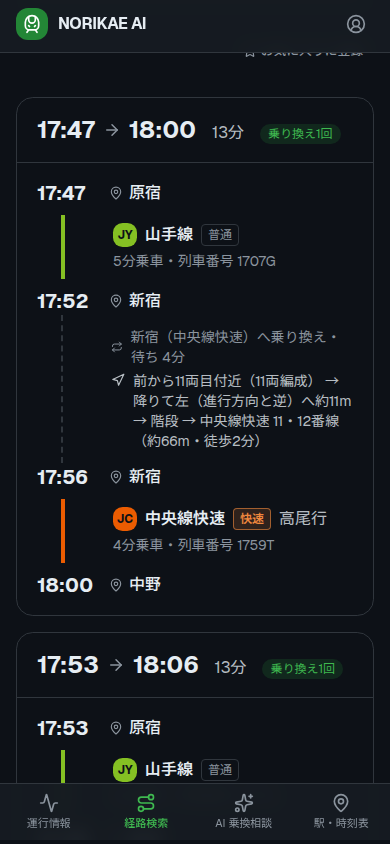
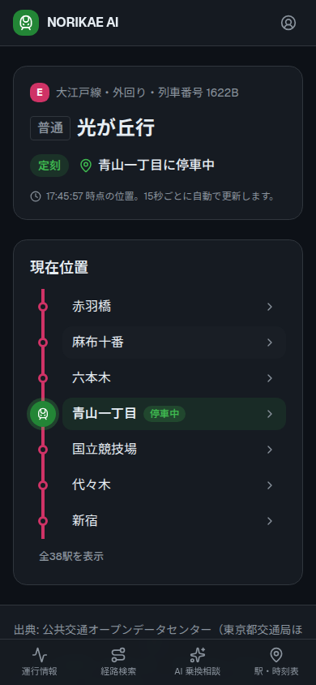

# NORIKAE AI

東京都内の鉄道の運行情報・列車位置・時刻表と、遅れを反映した乗り換え案内を、AI に話しかけて調べられる Web アプリです。公共交通オープンデータセンター（ODPT）を通じて各鉄道事業者が公開するオープンデータを利用しています。

> 本アプリは個人が作成した**非公式**のアプリで、各鉄道事業者・公共交通オープンデータセンターとは関係ありません。



# 🌍 Live Demo

| Service | URL |
| --- | --- |
| Application | https://d2ck0n8si4rgsn.cloudfront.net |
| Swagger UI | https://a2y4udf8gb.execute-api.ap-northeast-1.amazonaws.com/swagger/index.html |

ログインしなくても、すべての機能を使えます（ログインで増えるのはお気に入りと通知だけです）。

---

運行情報や列車位置などの動的データと、駅時刻表・列車時刻表などの静的データを組み合わせ、各路線・駅の情報の閲覧、遅れを反映した経路検索、AI との会話による照会ができます。

| AI 乗換相談・近くの駅 | 経路検索（乗り換える駅の中の案内） | 列車の現在位置 |
| --- | --- | --- |
|  |  |  |

# 対応路線

東京都内（島しょ部を除く）に駅のある、次の事業者の路線（設計は [docs/design/multi-operator.md](docs/design/multi-operator.md)）。

- 都営交通（浅草線・三田線・新宿線・大江戸線・東京さくらトラム・日暮里・舎人ライナー）
- 東京メトロ・JR東日本・京王電鉄・東武鉄道・りんかい線・つくばエクスプレス・多摩都市モノレール
- 東急電鉄・西武鉄道・小田急電鉄・京急電鉄・ゆりかもめ（列車時刻表が公開されていないため、経路検索では駅時刻表から推定した列車を使います。小田急・ゆりかもめは運行情報も無し）

列車の現在位置は、位置を配信している都営（日暮里・舎人ライナーを除く）・JR東日本・京王電鉄・東武鉄道・京急電鉄の路線で表示します。

都営以外の事業者のデータは、ライセンス（公共交通オープンデータ基本ライセンス・チャレンジ限定ライセンス）で再配布が禁じられているため、このリポジトリには含めていません。

本プロジェクトは、AWS のサーバーレスアーキテクチャを採用し、Terraform による Infrastructure as Code（IaC）、Go による REST API、React + TypeScript による SPA として構築しています。

---

# 主な機能

- 運行情報一覧
- 路線一覧・路線ごとの駅一覧
- 駅詳細
  - 時刻表（方面・平日・土休日別、行先・列車種別つき）
- 列車の現在位置（路線図上に表示。出発前・運行終了も案内）
- 経路検索
  - RAPTOR による乗り換え探索（直通運転は乗り換えなしで扱う）
  - 走行中の列車の遅れと、運行情報の見合わせを反映
  - 乗り換える駅の中の案内（JR東日本の新宿・東京・池袋・渋谷・品川・高輪ゲートウェイ）。何両目に乗るとよいか、降りて右・左どちらへ歩くか、階段・エスカレーター、乗り換え先のホーム・改札までの距離と時間
- AI チャット（Gemini）
  - 「次の電車は？」「遅れてる？」のような自然な文章で、運行情報・列車位置・時刻表・経路を聞ける
  - AI が道具（照会 API）を呼び、アプリが結果を返す、を繰り返して答える
- Google アカウントでのログイン（任意）
  - お気に入り（駅・路線・経路）
  - 登録した路線・曜日・時間帯に遅れや見合わせが起きたら Web Push で通知
- Swagger による API ドキュメント

---

# システム構成

```text
Browser
   │
CloudFront
   ├── Default (*) ── Amazon S3（SPA）
   │
   └── /api/*
           │
     Amazon API Gateway (HTTP API)
           │
       AWS Lambda（API） ──── Gemini API（AI チャット）
           │    ├── SSM Parameter Store（Gemini・ODPT・VAPID のキー）
           │    └── DynamoDB（利用者・お気に入り・通知の設定 / AI の利用回数）
           │
公共交通オープンデータセンター（ODPT）API

EventBridge（5分ごと）── AWS Lambda（通知。API と同じ実行ファイル）── Web Push
```

---

# 使用技術

## Frontend

- React 19
- TypeScript
- Vite
- Tailwind CSS v4
- shadcn/ui
- React Router
- TanStack Query
- Playwright（E2E テスト）

## Backend

- Go 1.25
- net/http（標準ライブラリ）
- REST API
- swaggo (Swagger/OpenAPI)
- RAPTOR（経路探索）
- Gemini API（AI エージェント・Function Calling）
- Web Push

## Infrastructure

- Terraform
- AWS Lambda（arm64）
- Amazon API Gateway (HTTP API)
- Amazon CloudFront
- Amazon S3
- Amazon DynamoDB（利用者・お気に入り・通知の設定、AI の利用上限の管理）
- Amazon EventBridge（通知の定期実行）
- AWS Systems Manager Parameter Store（API キーの保管）
- IAM
- GitHub Actions（CI/CD、OIDC で AWS に接続）

---

# 設計方針

## アーキテクチャ

- AWS Lambda を利用したサーバーレスアーキテクチャ。ほぼ無料枠で動かす
- Terraform による Infrastructure as Code（IaC）
- Router / Handler / Service / Client による責務分離
  - Handler は Service のエラーを HTTP ステータスに変換するだけにする
  - Service でデータの加工・集約を行い、ODPT の JSON-LD をフロント向けの DTO に変換する
  - 経路探索（`route`）・AI エージェント（`ai`）・ログイン（`auth`）・運行日の判定（`calendar`）は独立したパッケージにする
- ODPT の取得は Go Generics（`fetch[T]`）で共通化し、事業者ごとに並列に取る。一部の事業者が失敗しても残りを返す

## 性能（Lambda のコールドスタート）

- 時刻表などの静的データは `go:embed` で実行ファイルに埋め込み、外部の DB を使わない
- 約25MB ある時刻表の JSON は、使う項目だけに絞って文字列表にまとめた gob に変換してから埋め込み、起動時の読み込みを短くする

## 経路検索

- RAPTOR で探索し、走行中の列車の遅れ（路線・方向ごとの中央値）と運行情報の見合わせを30秒キャッシュして反映する
- 直通運転の列車は事業者ごとに別の列車としてデータに載っているため、境目の駅で行先と時刻からつなぐ
- 列車時刻表を公開していない5社は、駅時刻表の発車をつないで列車を推定する。推定の正しさは、列車時刻表のある事業者で本物と比べて測っている
- 駅の中の案内は、JR東日本の駅の歩行空間ネットワーク（通路のグラフ）と構内地図から、ホームの各号車の位置から乗り換え先までの最短の道を求めて作る。番線・改札の名前は手で対応表を作り、乗車位置の案内と照らして確かめた。求めた歩く時間は、経路検索の乗り換え時間にも使う
- 設計は [docs/design/route-search.md](docs/design/route-search.md)・[docs/design/station-guide.md](docs/design/station-guide.md)

## データの正しさ

- 列車番号は路線間・ダイヤ間で重複するため、列車は列車ID で特定する
- 運行日は3時前を前日として扱い、24時以降の時刻を扱う。祝日は祝日法から計算する

## AI エージェント

- AI は道具（Function Calling）で Service の照会を呼び、アプリが実行した結果を返す、を最大5往復する。時刻・遅れなどは AI に推測させず、アプリのデータから答えさせる
- 利用上限（アプリ全体の1日の回数・IP ごとの回数）を DynamoDB で数え、無料枠に収める
- 入力・応答の本文はログに残さない
- 設計は [docs/design/ai-api.md](docs/design/ai-api.md)

## セキュリティ・ライセンス

- API キー（Gemini・ODPT）は SSM Parameter Store に置き、Terraform・環境変数・ログに出さない
- GitHub Actions は OIDC で AWS に接続し、長期のアクセスキーを持たない。デプロイ用のロールには IAM を変える権限を与えない
- ログインは Google の ID トークンを検証して自前のセッションを発行する。保存するのは Google のユーザー ID だけで、メールアドレス・名前は保存しない（設計は [docs/design/login.md](docs/design/login.md)）
- 再配布が禁じられた他社のデータは、非公開の S3 に版を付けて置き、デプロイ時に取得して埋め込む。公開リポジトリには含めない

## 開発

- Docker Compose によるローカル開発環境の統一
- CI（GitHub Actions）で変更のあった領域だけを検証し、main へのマージで自動デプロイする
  - Backend: gofmt・vet・test・Swagger が最新か
  - Frontend: lint・build・Playwright の E2E テスト
  - Infra: terraform fmt・validate・plan

---

# API

| Method | Endpoint | Description |
|---------|----------|-------------|
| GET | `/api/status` | 運行情報一覧 |
| GET | `/api/routes` | 路線一覧 |
| GET | `/api/routes/{routeId}/stations` | 路線ごとの駅一覧 |
| GET | `/api/stations` | 全駅一覧 |
| GET | `/api/stations/{stationId}` | 駅詳細（時刻表） |
| GET | `/api/trains/{trainId}/location` | 列車現在位置 |
| GET | `/api/journeys?from={fromStation}&to={toStation}` | 経路検索（遅れを反映） |
| POST | `/api/chat` | AI チャット |
| POST | `/api/auth/google` ほか | ログイン・ログアウト |
| GET / DELETE | `/api/me` | ログイン中の利用者・退会 |
| GET / PUT / DELETE | `/api/me/favorites/...` | お気に入り |
| GET / PUT / DELETE | `/api/me/alerts/...` | 運行情報の通知の設定 |
| POST / DELETE | `/api/me/push-subscriptions/...` | Web Push の購読 |

詳細な API 仕様は Swagger UI から確認できます。

---

# 開発環境

Docker Compose を利用したローカル開発環境を構築しています。

Frontend・Backend をコンテナ分離し、開発環境を統一しています。

```text
Docker Compose

frontend
 └── React + Vite
      :5173

backend
 └── Go REST API
      :8080
```

起動

```bash
make up
```

都営以外の事業者のデータはリポジトリに含まれていないため、clone した環境では都営の路線だけで動きます。

---

# ライセンス

本アプリは、公共交通オープンデータセンターを通じて各鉄道事業者が提供するオープンデータを加工して利用しています。情報の正確性・完全性は保証しません。

| 事業者 | ライセンス |
| --- | --- |
| 東京都交通局 | [CC BY 4.0](https://creativecommons.org/licenses/by/4.0/deed.ja)（著作権は東京都交通局に帰属します） |
| 東京メトロ・東京臨海高速鉄道・首都圏新都市鉄道・多摩都市モノレール・ゆりかもめ | [公共交通オープンデータ基本ライセンス](https://developer.odpt.org/terms/data_basic_license.html) |
| JR東日本・京王電鉄・東武鉄道・京急電鉄・東急電鉄・西武鉄道・小田急電鉄 | [公共交通オープンデータチャレンジ限定ライセンス](https://developer.odpt.org/challenge_license)（公共交通オープンデータチャレンジ 2026 への応募のための利用。許諾は 2027年3月12日まで） |

**利用データ**

- 運行情報
- 路線情報
- 駅情報
- 列車ロケーション情報
- 駅時刻表
- 列車時刻表
- 歩行空間ネットワークデータ・構内地図（JR東日本の駅。提供: JR東日本コンサルタンツ、公共交通オープンデータチャレンジ限定ライセンス）
